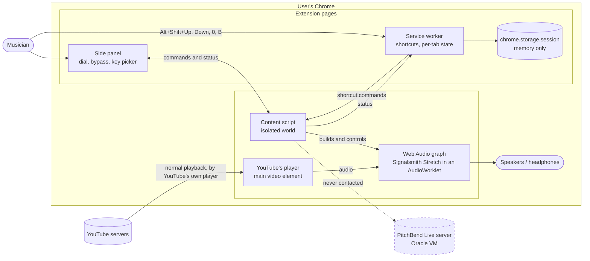
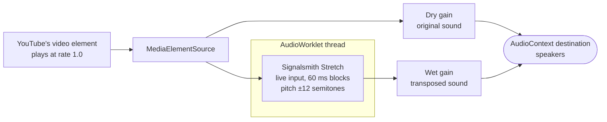
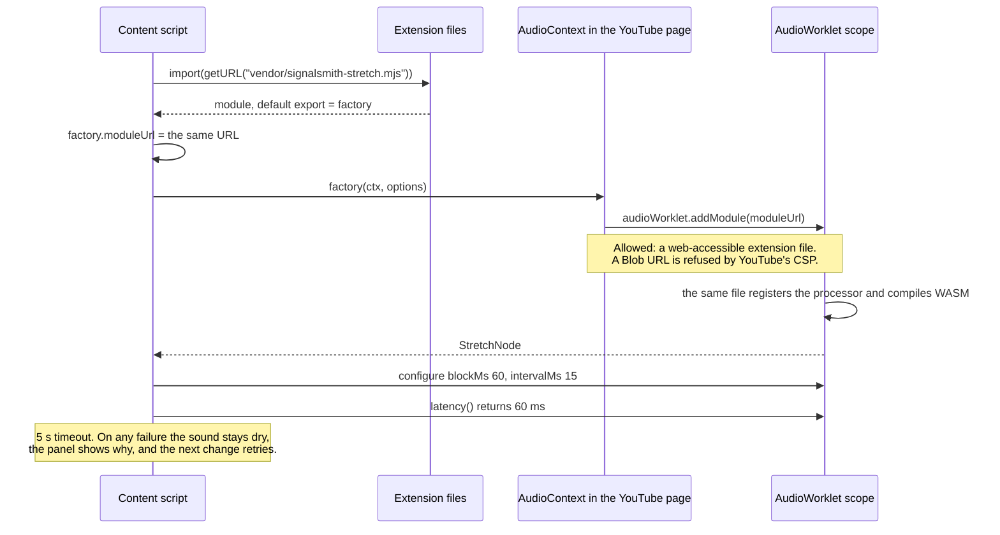
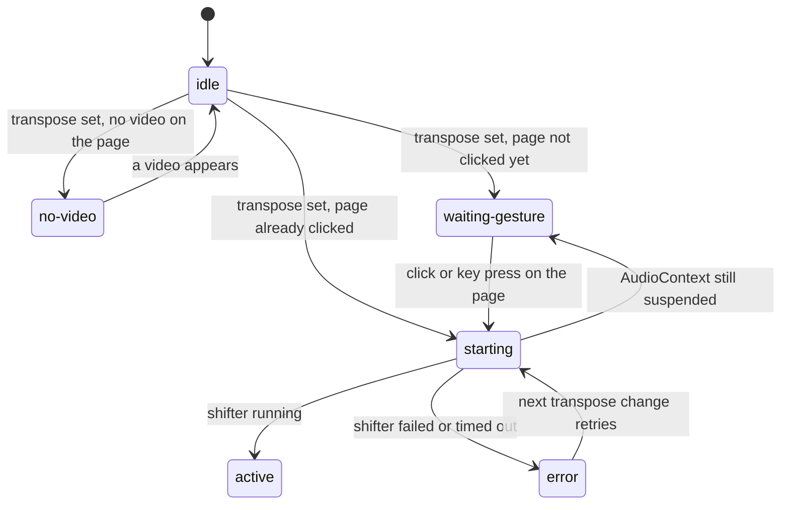
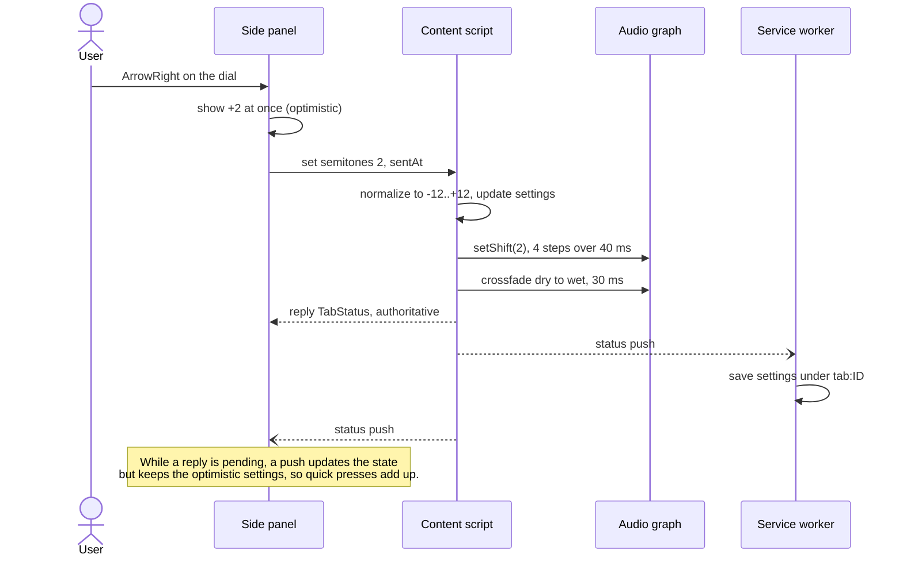
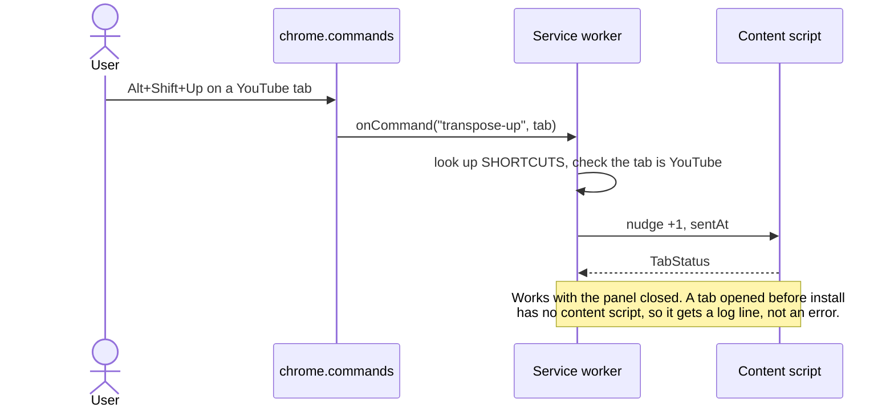
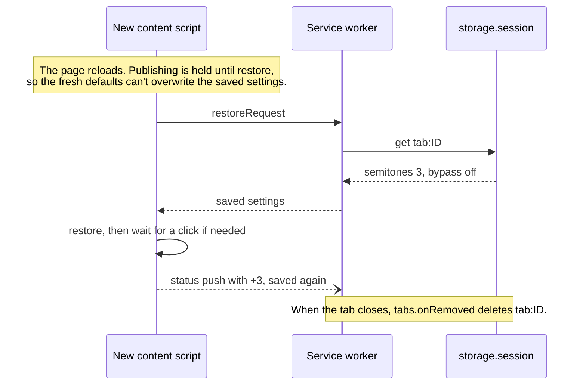
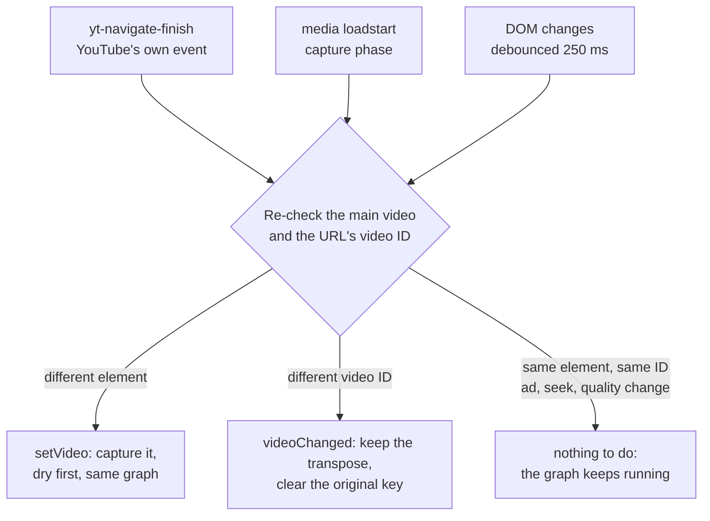
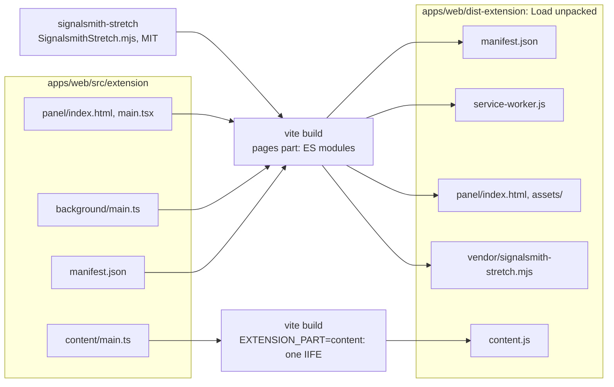
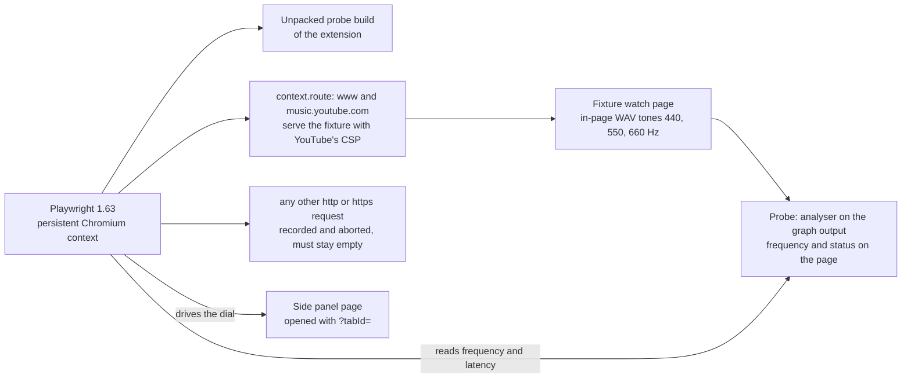

# PitchBend Live Chrome extension: system design

How the extension transposes a YouTube video live, in the user's own tab, without downloading anything.

| | |
|---|---|
| **Version** | 0.1.0 (branch `extension/live-transpose`, 2026-11-13) |
| **Decision record** | [ADR 0009](adr/0009-chrome-extension-live-transpose.md). It supersedes ADR 0008 and the desktop-shell spike |
| **Code** | [`apps/web/src/extension/`](../apps/web/src/extension/) |
| **Owner guide and manual checklist** | [`apps/web/src/extension/README.md`](../apps/web/src/extension/README.md) |

If this overview and the code or ADR 0009 disagree, the code and ADR win. Fix the overview.

---

## 1. The problem and the idea

- **The server can't fetch YouTube.** YouTube bot-checks the Oracle datacenter IP, so every YouTube link in the web app fails with `SOURCE_BLOCKED`.
- **Downloading isn't an option anyway.** The Chrome Web Store forbids extensions that "facilitate … the unauthorized access, download, or streaming of copyrighted content", and so do YouTube's ToS and CLAUDE.md §7.
- **The audio is already playing in the user's browser.** The extension takes the sound of YouTube's own `<video>` element, shifts its pitch with Web Audio, and plays the result. Nothing is fetched, stored, recorded or sent. The PitchBend Live server isn't involved at all.

| Goal | Target | How it's met |
|---|---|---|
| Pitch only, tempo untouched | A 4:00 song still ends at 4:00 | The video keeps its own clock at rate 1.0. The shifter changes pitch only (§3) |
| Small delay behind the picture | ≤ 80 ms | 60 ms shifter blocks + the output's base latency. Measured 70 ms (§7) |
| The dial feels immediate | ≤ 20 ms from panel to shifter | Direct extension messaging, no server. Measured 0.9 ms |
| Never silent | The video is never muted by a failure | The dry path is connected first, and the graph is never torn down (§3, §8) |
| Per tab, private | Settings forgotten when the tab closes | `chrome.storage.session`, which lives in memory only (§6) |
| Nothing leaves the browser | Zero network requests | No network APIs in the source. The e2e suite fails on any request (§9) |

## 2. Where it runs

The extension has four parts, all in [`apps/web/src/extension/`](../apps/web/src/extension/):

| Part | Runs in | Job |
|---|---|---|
| **Content script** (`content/`) | Every YouTube tab, in Chrome's isolated world. Built as one classic script, `content.js` | Finds the main video, builds and owns the audio graph, applies commands, reports status |
| **Pitch shifter** (`vendor/signalsmith-stretch.mjs`) | The tab's AudioWorklet thread | Signalsmith Stretch (MIT, WebAssembly) in live-input mode, shipped unchanged as a web-accessible resource |
| **Service worker** (`background/`) | The extension's background, woken by events | Routes keyboard shortcuts, saves each tab's settings in session storage, forgets closed tabs, opens the side panel from the toolbar icon |
| **Side panel** (`panel/`) | An extension page beside the tab (React) | The dial (the web app's `KeyDial`), bypass, the original-key picker, "G major → A major (+2)", capo, status and delay readout |

Shared code (`shared/`) holds the message protocol, the settings reducer and thin seams over the Chrome APIs. The extension reuses the web app's `src/audio/pitch.ts`, `src/audio/ramp.ts`, `src/lib/music.ts` and `KeyDial` read-only.

## 3. The audio graph

The content script builds one graph per tab, the first time a transpose is asked for:

- **Capturing:** `createMediaElementSource(video)` reroutes the element's sound into this graph, so from then on it only comes out through the graph. That's why the rules below exist.
- **Dry first:** the dry path is connected at full gain *before* the shifter is loaded. The moment the video is captured, you hear the original, unchanged.
- **Crossfade:** when the shifter is running and the transpose isn't 0, the dry gain fades to 0 and the wet gain to 1 over 30 ms. Bypass, a transpose of 0, or any error fade back to dry. At 0 you hear the true original, with no added delay.
- **Never torn down:** a captured source is never disconnected and the AudioContext is never closed, because either would mute the video. The graph lives as long as the page.
- **Pitch changes glide:** each new semitone value is applied in 4 steps over 40 ms (`PitchRamp`, with `node.schedule({ semitones })`), so dial moves don't click.
- **Tempo is untouched:** the video element still drives playback at its own rate. In live-input mode the stretcher only shifts pitch, so the song keeps its length. The sound simply trails the picture by the shifter's latency.
- **Same element, new source:** ads, the next video and quality changes usually keep the same `<video>` element and swap its source. The graph keeps running through them, so ads are transposed too.

## 4. Loading the shifter under YouTube's CSP

The library normally loads its worklet code from a Blob URL, and YouTube's Content Security Policy refuses those. The extension ships the library's `.mjs` file as-is and points both the import and the worklet at it. The same file registers the processor when it loads inside a worklet. Spike E1 proved this against YouTube's real CSP (+12 on 440 Hz measured 882 Hz).

- Only that one file is web-accessible, and only to the two YouTube origins.
- WebAssembly compiles because YouTube's CSP allows `'unsafe-eval'`.
- If YouTube ever tightens its CSP, ADR 0009 records the fallback: `tabCapture` plus an offscreen document.

## 5. The tab's state machine

`ContentController` (`content/controller.ts`) decides when audio may be touched. It never creates an AudioContext before the page has had a user gesture, because Chrome would start it suspended. Capturing the video into a suspended context would mute it.

| State | What you hear | Panel says |
|---|---|---|
| idle | The original (the graph doesn't exist yet) | "Ready. Move the dial to transpose this video." |
| no-video | The original | "No video found on this page." |
| waiting-gesture | The original, untouched | "Click the video once to enable PitchBend Live." |
| starting | The original (dry path) | "Starting the pitch shifter…" |
| active | Transposed, or the original when bypassed or at 0 | "Transposing this tab." plus the delay |
| error | The original (dry path) | The reason, e.g. "The pitch shifter couldn't start. The video plays without transposing." |

## 6. Messages and state

All messaging stays inside Chrome's extension APIs. Messages are typed in `shared/protocol.ts`, checked by runtime guards, and accepted only from this extension's own ID.

| Message | From → to | Carries |
|---|---|---|
| `Command`: `set`, `nudge`, `reset`, `setBypass`, `toggleBypass`, `setKey`, `getStatus` | Panel or service worker → content script (`chrome.tabs.sendMessage`) | The change, plus `sentAt` for latency measurement |
| `TabStatus` (the reply) | Content script → whoever sent the command | State, settings, site, shifter and added latency, error text, timestamps |
| `status` push | Content script → all extension pages (`chrome.runtime.sendMessage`) | The same `TabStatus`, on every change |
| `restoreRequest` | Content script → service worker | Asks for this tab's saved settings after a reload |

Every semitone value passes through one normalizer (`tabState.ts`: clamp to −12…+12 and round), whether it comes from the panel, a shortcut or a restore.

### A dial move

### Keyboard shortcuts

### Reload and close

A command that arrives before the restore reply wins over the saved settings, because it's newer.

## 7. Following YouTube's single-page navigation

YouTube rarely reloads the document. The next video usually reuses the same `<video>` element with a new source. `VideoTracker` (`content/videoTracker.ts`) watches for both kinds of change:

- **Finding the main video:** `#movie_player video.html5-main-video`, then `video.html5-main-video`, then the largest `<video>` on the page.
- **The video ID** comes from `?v=` or `/shorts/<id>`. It's held in memory only and never stored.
- **The key is cleared on a new video** so the readout never names the wrong key. The transpose stays, because a musician usually practices a set in one key.

## 8. Latency budget

| Stage | Time | Notes |
|---|---|---|
| Panel input → shifter | **0.9 ms** measured | AC-2 limit 20 ms. The panel and the content script share timestamps (`performance.timeOrigin + now()`) |
| Pitch glide | 40 ms | 4 steps, to avoid clicks. It doesn't delay the audio |
| Shifter latency | **60 ms** | `blockMs: 60`. The library's default preset is 120 ms |
| Output base latency | ≈ 10 ms | `AudioContext({ latencyHint: "interactive" })`. Depends on the device |
| **Sound behind picture** | **70 ms** measured | AC-3 limit 80 ms. The panel shows the live figure. At 0 or bypass it's only the base latency |
| Change audible at the output (test) | ≤ 176 ms measured | AC-2 limit 500 ms. Includes the test analyser's 8192-point window |

The figures were measured by the Playwright e2e suite in Chromium. The perceptual checks (dial feel under 100 ms, lips and drums not feeling late) are in the manual checklist.

## 9. Privacy, permissions and safety

| Manifest entry | Value | Why |
|---|---|---|
| `permissions` | `sidePanel`, `storage` | The panel, and `chrome.storage.session` for per-tab settings |
| `host_permissions` | `https://www.youtube.com/*`, `https://music.youtube.com/*` | Inject the content script there and nowhere else |
| `web_accessible_resources` | `vendor/signalsmith-stretch.mjs`, YouTube origins only | The worklet loading in §4 |
| `commands` | four shortcuts | `Alt+Shift+Up/Down/0/B` |
| Not requested | `downloads`, `tabCapture`, `tabs`, `cookies`, remote code, a custom CSP | Nothing is downloaded, recorded or sent |

- **Stored:** only `{ semitones, bypass, key }` per tab, in memory-only session storage. It's deleted when the tab closes and wiped when Chrome quits. There's no telemetry, and logs go only to the local DevTools consoles, prefixed `[PitchBend Live]`.
- **Guarded by tests:**
  - `manifest.test.ts` pins every manifest entry above.
  - The same test scans the extension's source and fails on `fetch(`, `XMLHttpRequest`, `WebSocket`, `sendBeacon`, `EventSource`, `chrome.downloads`, `storage.local`/`sync`, `document.cookie`, `innerHTML`, `eval` and `MediaRecorder`.
  - The e2e suite records any http(s) request that isn't the fixture and fails if there is one.
- **Trust boundary:** the content script accepts commands only from its own extension ID, and every message is shape-checked. The page can't send it commands.

## 10. Failure modes

| Failure | You hear | Panel shows | Recovery |
|---|---|---|---|
| The page hasn't been clicked yet | The original | "Click the video once to enable PitchBend Live." | One click on the page |
| The shifter can't load (CSP or WebAssembly blocked, 5 s timeout) | The original | The error, and that the video plays without transposing | The next change retries. ADR 0009's fallback is `tabCapture` |
| Another extension already captured the video | The original | "Another extension or the page already controls this video's audio." | Disable the other extension |
| The tab was open before install or update | The original | "Reload this YouTube tab to start PitchBend Live." | Reload the tab |
| No video on the page | Nothing changes | "No video found on this page." | Automatic when a video appears |
| YouTube changes its player markup | The original, or the largest video | Depends on what's found | The fallback selector, then a code fix |
| The service worker was asleep | No effect | — | MV3 wakes it on the next event. Settings are in session storage, not worker memory |

Rollback is disabling or removing the extension in `chrome://extensions`, which leaves YouTube untouched. There's no server, migration or contract change.

## 11. Build and packaging

- **Two builds** (`apps/web/vite.extension.config.ts`), because a content script must be a single classic script while the panel and worker are ES modules. `make extension` runs both in the web container.
- **The library file is copied byte for byte.** It isn't bundled, because it must be the same file the worklet loads.
- **The probe build** (`--mode probe`) adds test hooks and goes to `node_modules/.cache/extension-probe-dist`, so it can't be mistaken for the real build. The production build contains no probe code (checked).
- The extension lives inside `apps/web`, sharing its lockfile, Docker image and `make check`. A separate package was rejected in ADR 0009.

## 12. How it's tested

| Layer | Runs | Covers |
|---|---|---|
| **Unit** (Vitest, fakes for Web Audio and Chrome) | `make test-web`, `make check`, CI `web` | Every module except the three `main` wiring files, at 100% line and branch coverage. State machine, graph rules, normalizer, protocol guards, panel copy, manifest and source scan |
| **End to end** (Playwright Chromium) | `make test-extension`, CI `extension-browser` | +2 → 493.9 Hz at rate 1.0, latency, waiting for a click, worklet failure stays at 440 Hz, bypass, next video and ads, reload and close, two tabs, shortcuts, YouTube Music, zero network |
| **Manual** (owner, real YouTube) | The checklist in the extension README | 10-minute soak, real ads, stable Chrome on macOS, perceived latency and A/V offset, corporate-policy check |

Two test-only notes:
- Playwright's Chromium evaluations count as user gestures, so the "before any click" test uses a probe-only `pblProbeNoActivation` flag. The click that then resumes the audio is real.
- Headless Chromium can't press browser-level shortcuts, so the probe service worker exposes `pblShortcut(name)`, which calls the same handler.

## 13. Not in v0.1 (yet)

- **Automatic key detection:** the user picks the original key. A progressive in-browser estimate is planned for v2.
- **Cents fine-tuning:** deferred.
- **Chrome Web Store publishing:** the build is store-compatible, but publishing has a one-time fee and is the owner's call.
- **Other sites and embedded players:** out of scope. Only the two YouTube origins.
- **Windows and older Chrome:** not tested. v0.1 targets the owner's current stable Chrome on macOS.
- **Downloading or exporting YouTube audio:** never. Exporting with the transpose applied stays in the web app, for uploaded files.
